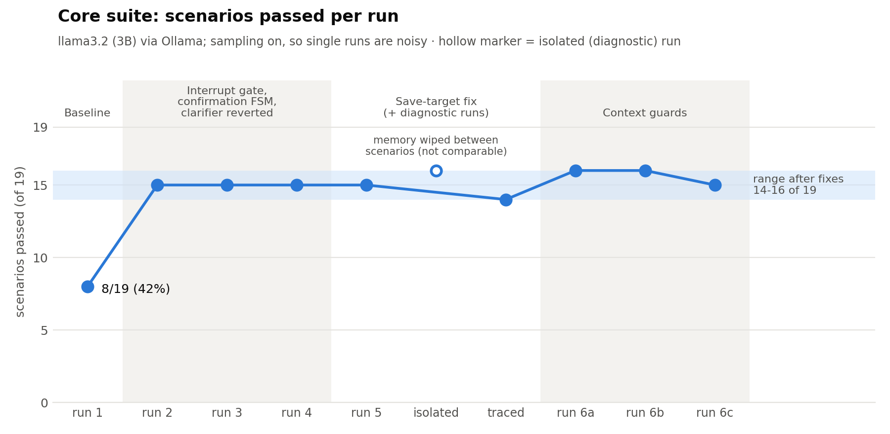
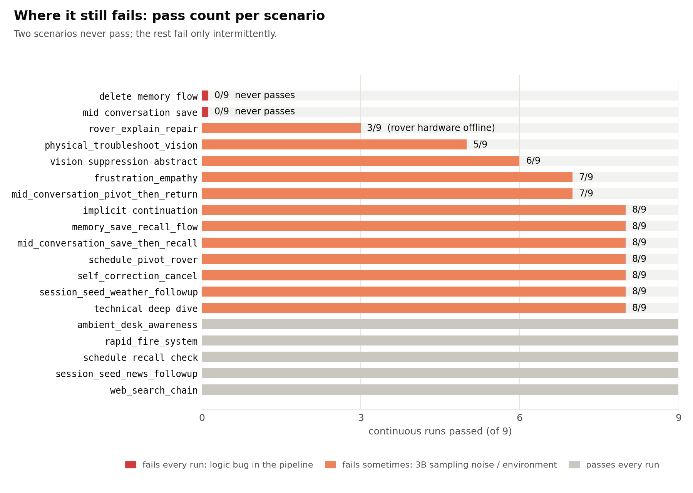

# Buddy

A voice-first personal assistant that runs on a **local 3B model**, built as a system you can measure: an ear (VAD, speaker
verification, STT), a layered decision pipeline (interrupts, confirmations, intent routing, memory, belief state), and a mouth
(TTS with music ducking). It delegates long tasks to an agent (Friday) and has clients for a rover and a Tello drone.

The interesting part is not that it talks, it is that **every failure I fixed was found by a harness I built to catch it**.

<picture>
  <source media="(prefers-color-scheme: dark)" srcset="docs/img/pass_rate_by_run_dark.png">
  
</picture>

| | |
|---|---|
| Evaluation | 11 scenario suites, a runner with context-bleed detection, `--isolate`, and prompt tracing |
| First run of the 19-scenario core suite | **8/19 (42%)** |
| After the fixes (continuous runs) | **14-16/19 (74-84%)**, about one scenario of run-to-run noise |
| Honest caveat | author-written keyword checks, 3B sampling noise, rover offline; see [EVALUATION.md](docs/EVALUATION.md) |

## Start here

- [docs/ENGINEERING_LOG.md](docs/ENGINEERING_LOG.md): seven problems, how they were found, and the dead ends
- [docs/EVALUATION.md](docs/EVALUATION.md): how the harness works and what the numbers do and do not show
- [docs/ARCHITECTURE.md](docs/ARCHITECTURE.md): ear -> brain -> mouth, with a layer diagram
- [docs/SPEAKER_RECOGNITION.md](docs/SPEAKER_RECOGNITION.md): VAD + ECAPA speaker verification lab

## What is in the code

- **Layered request handling** (`brain/conversation_manager.py`): interrupt -> pending-state FSM -> intent routing -> memory-task
  fusion -> RAG prompt. Deterministic code decides before the LLM does.
- **Belief state, episodic memory router, memory-task fusion** (`brain/belief_state.py`, `brain/memory/`).
- **Delegation to Friday** (`brain/friday/`): every task carries an instruction not to read or report secrets. A prompt-level
  constraint, not a sandbox.
- **Intent-classifier pipeline** (`tools/`, `brain/intent_model/`): LLM-assisted labelling with consistency checks, leakage-free
  input formatting, class-weighted DistilBERT fine-tuning, shadow-mode serving.
- **Voice front-end** (`ear/`, `mouth/`, `speaker_recognition/`): adaptive-noise-floor VAD with pre-roll and end-of-turn grace,
  self-mute while speaking, speaker verification in an isolated subprocess (JSON-lines protocol), Spotify volume ducking.
- **Devices** (`devices/`): rover websocket client with a mock server for hardware-free tests, Tello client.

## Quick start (text mode, no hardware)

Needs **Python 3.10+** (CI runs 3.10).

```bash
python -m venv .venv && source .venv/bin/activate        # Windows: .venv\Scripts\activate
pip install -r requirements.txt
python -m spacy download en_core_web_sm
ollama pull llama3.2                                      # Ollama must be running

python run_eval.py unit        # offline checks, no LLM
python text_chat.py            # talk to it in the terminal
python run_eval.py alive       # the 19-scenario conversational suite
python run_eval.py results     # committed results
python results/plot_results.py # regenerate the charts (needs matplotlib)
```

Machine-specific values (device paths, default city) go in `config.example.yaml` -> `config.yaml`; secrets only in environment
variables. Nothing personal is read from the repo. The voice stack needs `requirements-voice.txt` plus a microphone.

## Known limitations

<picture>
  <source media="(prefers-color-scheme: dark)" srcset="docs/img/scenario_reliability_dark.png">
  
</picture>

- **Two flows fail every run, so they are bugs in my code, not model noise.** `delete_memory_flow` asks for confirmation before
  checking that the topic exists; `mid_conversation_save` fails on the final "yes". Both are in the confirmation state machine.
- **The least reliable of the rest are rover and vision scenarios** (3/9, 5/9, 6/9). The rover hardware was offline for these
  runs, so `rover_explain_repair` is not a meaningful result; the 8/9 cases are within the 3B model's sampling noise.
- `brain/conversation_manager.py` is ~8.4k lines that grew organically.
- The context guards are justified by a prompt trace, not yet by a controlled A/B.
- The text mode and `alive` suite were exercised on my Windows machine; they have not been verified on a clean Linux/macOS install.
- Speaker verification has no published error rates and no anti-spoofing.
- The intent-model weights, training data (real conversations) and metrics are not included.

## Roadmap

In order, each one checked against the scenario suite before and after:

1. Fix the two always-failing confirmation flows (check that the topic exists before asking; trace why the mid-conversation save fails on the final "yes").
2. Split `ConversationManager` into one handler per layer, using the 19-scenario suite as the regression net.
3. A/B the context guards: `BUDDY_CONTEXT_GUARDS=0` vs. default, several runs each.
4. Pin dependency versions and verify a clean install on Linux.

## License

MIT, see [LICENSE](LICENSE).
