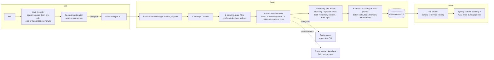

# Architecture

Buddy is a local-first assistant: speech in, a layered decision pipeline, speech out. The language model is a 3B model
(`llama3.2` via Ollama), so most of the engineering is in deciding *what* to ask the model and *when not to*.

## Where things live

| Area | Path | Notes |
|---|---|---|
| Request pipeline | `brain/conversation_manager.py` | `ConversationManager.handle_request` and the layers above. Large and historically grown: splitting it is the top refactor. |
| LLM calls, memory tiers | `brain/core/` | `brain.py` (recent-exchange buffer, per-topic memory, ChromaDB long-term memory), `prompts.py`, `RAG/` |
| Belief state | `brain/belief_state.py` | domain / phase / entities / last tool result per turn; resets on topic change |
| Episodic memory + fusion | `brain/memory/` | embedding-based episode router, memory-task fusion decision |
| Confirmation | `brain/router/confirmation_router.py`, `brain/utils/confirmation.py` | yes / no / redirect / unclear resolution shared by every confirm flow |
| Interrupts | `brain/utils/interupt_detector.py` | boundary-aware cancel detection ("never mind" only counts when it starts a clause) |
| Context-bleed guards | `brain/utils/context_guards.py` | one flag, `BUDDY_CONTEXT_GUARDS=0` disables |
| Delegation | `brain/friday/` | Friday dispatch with a secret-handling constraint injected into every task; job scout |
| Awareness | `brain/adaptive/` | schedule awareness, calendar, holiday checks, session recap, startup scan |
| Intent model | `brain/intent_model/`, `tools/` | shadow-mode classifier and the data / training pipeline (see the engineering log) |
| Voice I/O | `ear/`, `mouth/`, `speaker_recognition/` | see [SPEAKER_RECOGNITION.md](SPEAKER_RECOGNITION.md) |
| Devices | `devices/` | rover websocket client + mock server, Tello client |
| Evaluation | `buddy_alive_test_runner.py`, `scenarios/`, `eval/` | see [EVALUATION.md](EVALUATION.md) |

## Design choices worth knowing

- **Layers before the LLM.** Interrupts, pending confirmations and device commands are decided by deterministic code first,
  because a small model is unreliable at "did the user just say yes?".
- **One resolver for yes/no.** Every confirm flow goes through `resolve_confirmation` (CONFIRM / DECLINE / REDIRECT / UNCLEAR),
  so behaviour cannot drift between flows.
- **The LLM sees little, on purpose.** Recent-exchange context is only included when the message is a follow-up or similar to
  it; the belief block is reset on topic change. See the engineering log for why.
- **Secrets stay out of delegated agents.** Friday tasks carry an explicit instruction not to read or report `.env` files,
  keys or tokens. This is a prompt-level constraint (defence in depth), **not** a sandbox.
